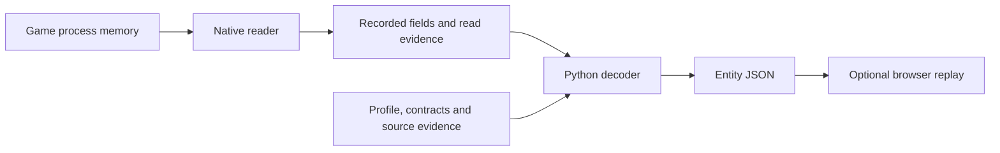

# Overwatch Decoder

A research decoder for turning recorded Overwatch process-memory reads into structured entity data: object identity, position, hero resources, current health and related observations.

**GitHub:** [paulantir0/overwatch-decoder](https://github.com/paulantir0/overwatch-decoder) · **Recorded replay demo:** [overwatch.paulantir.com](https://overwatch.paulantir.com/)

The decoder is Python and can be studied and tested on Ubuntu. The Windows code in this repository is the reader used in earlier experiments; it is separate from the decoder. A browser viewer can replay the resulting data.

**Current state:** the decoder source, validators, tests and research documentation are available. Complete game-build recipes, calibrated input bundles and original recordings are absent from this checkout. It is therefore a decoder research repository, with no verified current-build live-capture release. The documentation below records what the surviving source and historical notes establish.

## How it worked

The game stores objects and their properties in memory. The reader copied selected bytes while the game ran. The decoder checked which object those bytes belonged to and interpreted the supported fields.



For example, three changing decimal values might be a position. That alone does not tell us whose position it is. The decoder also needs the object's identity, its relationship to a player controller, and evidence that those relationships still held when the values were read. Otherwise the output stays unknown.

The screenshots and gameplay video were separate comparison evidence. The decoder did not use OCR or computer vision to obtain these memory fields. The Python projections interpret supplied data; they do not execute the game's functions.

## What memory fields we targeted

“Supported” here describes the implementation or the historical trials named in the reference. It does not mean every field works for every hero, game mode or game update.

| Target | What was read or calculated | What the result means |
| --- | --- | --- |
| Controller identity | Handle and manager/creation-key words | Which controller object a sample belongs to; not a permanent player account ID. |
| Controller ↔ body | Controller body reference, body handle/key and acquisition ownership checks | Connect a controller to the body whose fields are being read. |
| Current local context | A guarded selector and its controller/body references | Establish the selected local context for a reviewed route. |
| Other forward-owned objects | Full controller key, forward reference and owned-object key | Preserve associated objects separately from confirmed player bodies. |
| Position | Three 32-bit floats: X, Y, Z | A sampled body/component position in game coordinates. |
| Velocity | Three-float motion candidates in earlier experiments | Historical movement comparisons; no general velocity field is exposed by the current selected-entity view. |
| Orientation | Four-float quaternion candidate | Raw orientation storage; exact camera aim, pitch conventions and FOV remain unvalidated. |
| Hero | Low/high resource words, joined into a 64-bit GUID | A hero-resource identifier; a supplied build-scoped catalogue can provide a label. |
| Current health | Occupied pool values and membership checks | A guarded sum of current pools. This does not automatically identify maximum health, armor or shields. |
| Health ratio | Separately recorded numerator and denominator operands | A qualified native-ratio candidate, only when those operands were actually captured. |
| Health change | Difference between eligible consecutive health samples | A sampled increase/decrease; it does not identify the cause or attacker. |
| Category / ally / enemy | Flag words, local context and reviewed category rules | Raw categories, or a relative relation in the supported reviewed branch. |
| Account/name | Four account-token words and separately acquired UTF-8 string bytes | A source-bound name route. Peer names and arbitrary-match identity were not established generally. |
| Cached labels | Controller-keyed cached string bytes | A label candidate, kept separate from a verified account name. |
| Ammunition | Tagged base/cache values, expression state and optional callback operands | A reviewed count candidate; firing and reload flags remain unknown. |
| Cooldowns / timers | Counter, timestamp, base and rate operands | A reconstructed timer for a reviewed layout; historical Ana trials supplied controlled evidence. |
| Blink / Recall | Charge-like resources, state changes, timers and health/ammo responses | Scoped historical experiments, not a portable all-build ability decoder. |
| Ultimate / Pulse Bomb | Resource-provider operands and state changes | Research candidates. No universal charge-percentage or projectile-event mapping was established. |
| Outgoing feedback | Circular records containing another entity key, tick, integer amount and flags | Controlled local feedback observations; no guarantee of exact damage or complete hit counts. |
| Incoming source | Guarded context-vector headers and identity payload words | Narrow controlled source observations; not a general attacker/damage event stream. |
| Visibility | No validated field | Remains unknown. Having an object's position does not prove it was visible. |

The [memory-field reference](docs/memory-fields.md) gives the exact contract roles, legacy field-name patterns, data types and implementing files. The [historical findings](docs/research-findings.md) explain which experiments supported these interpretations and which candidates were rejected.

## What the “codes” mean

Several different identifiers appear in this project. They are easy to confuse:

| Example | Kind of identifier | Meaning |
| --- | --- | --- |
| `part36`, `part51`, `part83` | Legacy tags in profile field names | Account-token, body-reference and hero-resource field families respectively. These are not byte offsets. |
| `0x02E0000000000003` | Historical hero-resource GUID | Tracer in the documented build-scoped mapping. Ashe and Ana mappings are listed in the findings. |
| `0x075`, `STUHero` | Asset type and class name | Identify typed hero assets used to corroborate labels. |
| `127`, `-4` | Sampled native lookup identifiers | Investigated during firing research. They stayed constant during firing and were rejected as a firing flag. |
| `f32x3`, `i32` | Storage types | Three 32-bit floats, or one signed 32-bit integer. These say how bytes are read, not what they mean in gameplay. |
| `pool_sum_f32`, `elapsed_i64_f32_v1` | Decoder codec names | Current-pool summation and sampled timer arithmetic. |
| `overwatch-decoder.field-stream/4` | File-format schema | Identifies our recording format, not a code inside Overwatch. |
| SHA-256 strings | Content hashes | Identify an exact executable, profile, contract or evidence file. They are not memory addresses. |

An **address** is a location in one running process. An **offset** is a displacement used to reach a field from a module or object. A **recipe** describes how to locate and validate the right objects for a particular executable build. A **profile** records the resulting field locations, types and checks for that acquisition. A **contract** tells the decoder which fields have which roles.

Those roles and checks are documented here. The missing recipes' actual addresses, offsets and native-function locations are not embedded in the generic Python modules. Unit-test addresses are synthetic examples, not recovered Overwatch offsets.

## Start on Ubuntu

Python 3.11+ and Node.js are sufficient for the portable verification gate:

```bash
python3 -m venv .venv
.venv/bin/python -m pip install -e '.[dev]'
PYTHON=.venv/bin/python scripts/check.sh
```

This runs the Python and JavaScript tests with synthetic inputs. It needs no game, administrator access or Windows computer. Test success verifies the implementation's rules; it does not establish compatibility with a live game build.

To inspect the decoder's interfaces:

```bash
.venv/bin/python tools/entity-decoder/selected_entity_view.py --help
.venv/bin/python tools/entity-decoder/export_relations.py --help
```

Decoding a real recording additionally requires its original profile, acquisition evidence and applicable contracts/reviews. See the [selected-entity interface](tools/entity-decoder/selected-entity-view.md) and [verified-recording exporter](tools/entity-decoder/README.md#export-a-verified-recording).

## Where the code is

| Location | Role |
| --- | --- |
| [tools/entity-decoder](tools/entity-decoder) | Relations, selected entities, labels, categories, ammunition, event observations and stream composition. |
| [overwatch_decoder](overwatch_decoder) | Shared health arithmetic, health contracts and session-observation normalization. |
| [windows/Observer](windows/Observer) | Native field reader, acquisition engine, codecs and saved-recording verification. Its source documents the acquisition side. |
| [tools/entity-replay](tools/entity-replay) | Optional 3D replay and converters. |
| [tools/field-replay](tools/field-replay) | Optional viewer for individual recorded fields. |
| [tools/environment-geometry](tools/environment-geometry) | Separate Workshop ray-survey imports for sparse replay geometry. These are not memory-decoded maps. |
| [windows/SessionRecorder](windows/SessionRecorder) | Supporting historical video/audio/input recorder. It is not required to study or test the Python decoder. |
| [docs/protocol](docs/protocol) | Native and Python storage formats. |

## Reading a decoded value

A useful output needs more than a number. It retains the process/build identity, object keys, profile and source hashes, read start/end times, validation status and any unknown reason. A **guard** is a supporting identity/ownership byte check sampled around the field read. Failed guards invalidate the fields that depend on them.

Reads happen sequentially. They are not one atomic picture of the whole match. Gaps, object replacement and changed ownership stay explicit, and an old value does not fill a missing current observation. Historical success on one executable build does not establish support after a game update.
